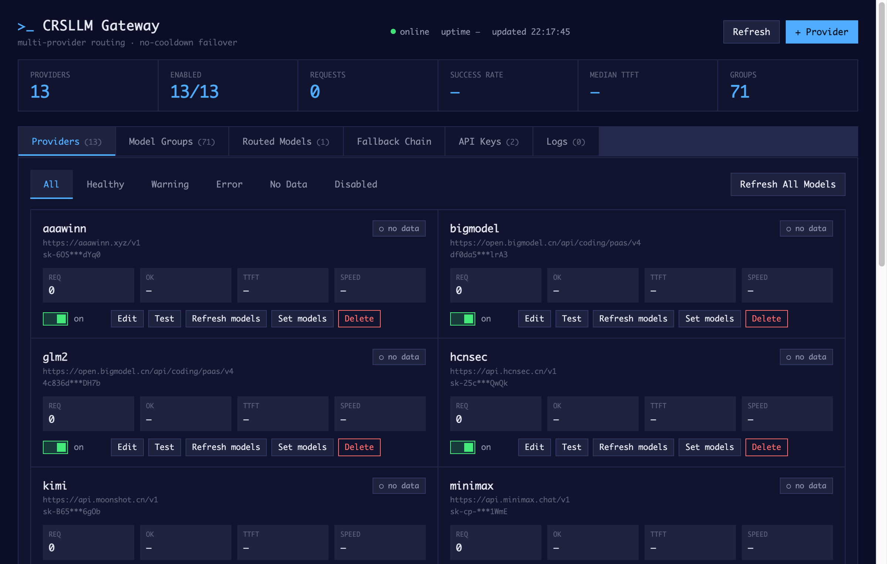
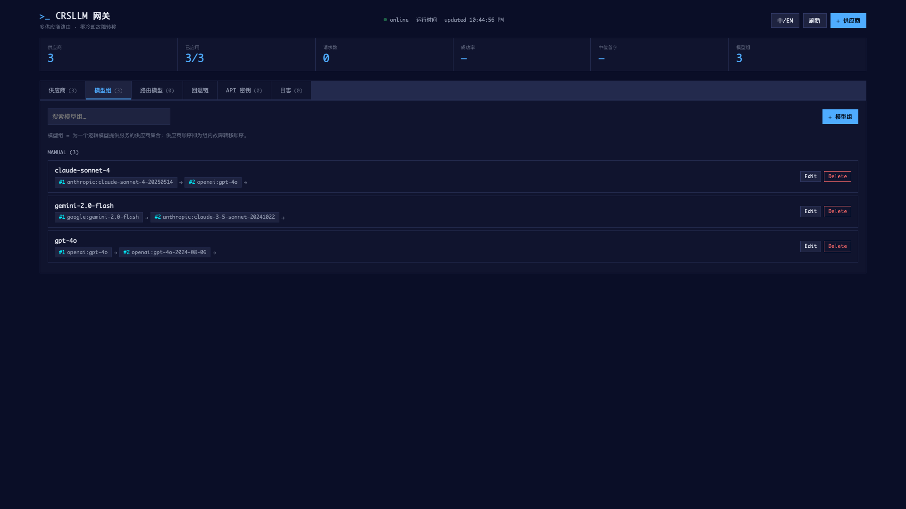
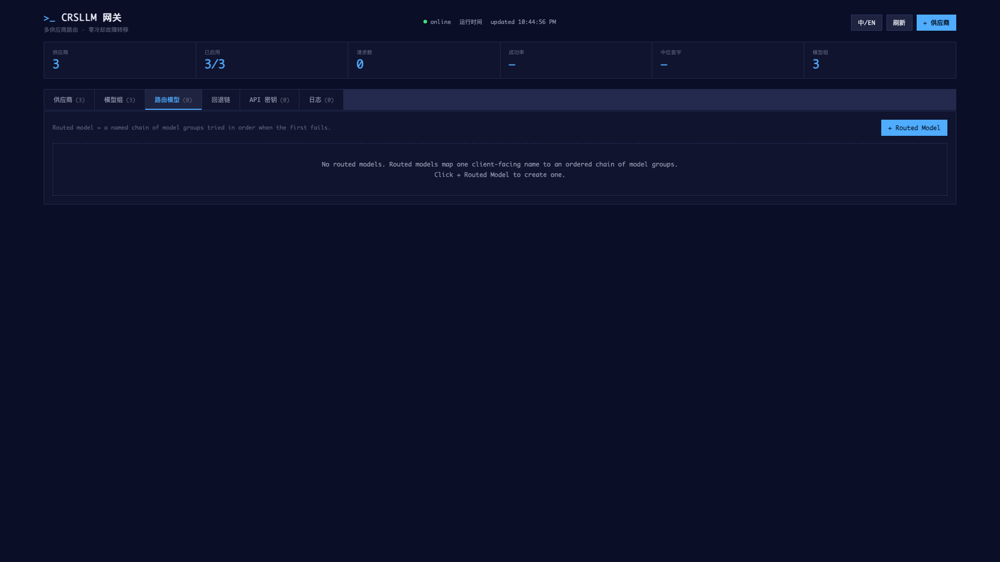
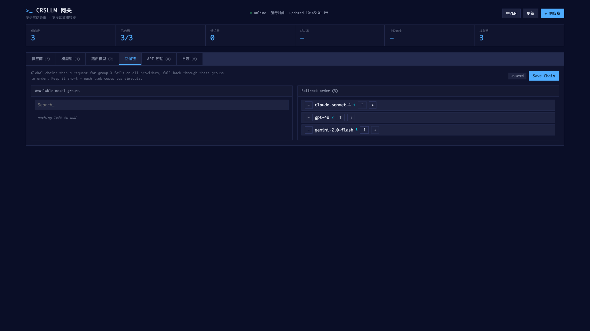
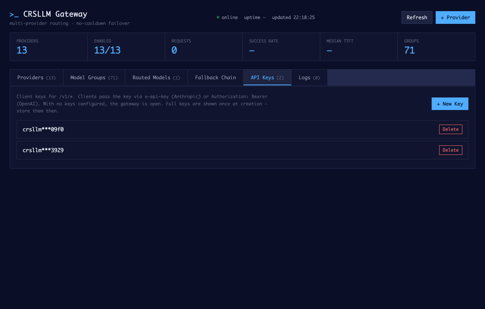
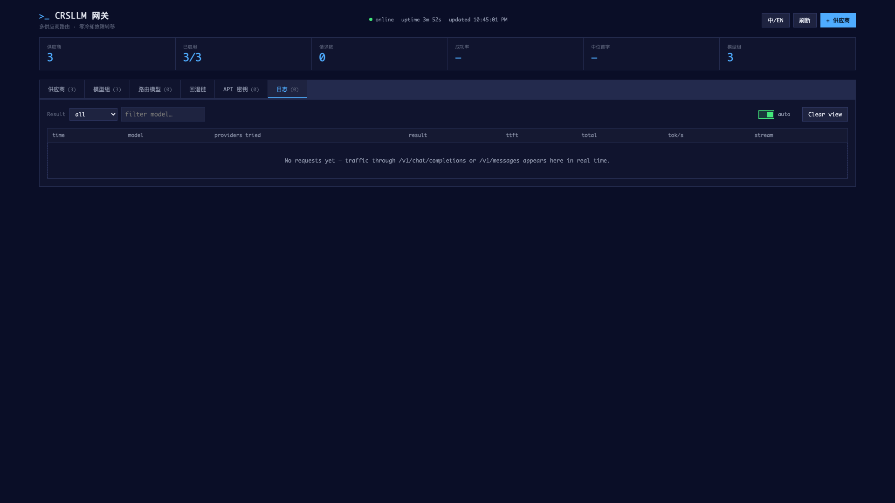

<p align="center">
  
</p>

<h1 align="center">CRSLLM · 多供应商 LLM 网关</h1>

<p align="center">
  独立 Rust 多供应商 LLM 网关：统一 Anthropic / OpenAI 接口 · 自动故障转移 · 实时 Web 控制台<br>
  A standalone Rust gateway that unifies Anthropic & OpenAI APIs behind one endpoint, with automatic provider failover and a live web console.
</p>

<p align="center">
  <a href="https://github.com/lingion/crsllm/releases"></a>
  
  
  
  
  
</p>

<p align="center">
  <a href="README.md">English</a> · <a href="https://github.com/lingion/crsllm/releases">发布页</a> · <a href="#接入-codex--claude-code">Codex / Claude Code 接入</a>
</p>

---

> **SEO 关键词：** 多模型网关、LLM 网关、供应商故障转移、自建 AI 网关、OpenAI 兼容代理、Anthropic API 网关、模型路由、Rust 网关、LiteLLM 替代、Claude Code 代理、Codex 代理、API Key 管理、SSE 流式网关、LLM gateway、provider failover、self-hosted AI gateway

---

## 功能特性

### 供应商管理与模型发现

<p align="center">
  
</p>

- **81 个预配置供应商**（OpenAI、Anthropic、Google、Azure、AWS Bedrock 等）
- **自动发现**：一键获取每个供应商的所有可用模型
- **健康监控**：实时延迟、成功率和请求计数
- **即时启停**：无需重启即可启用/禁用供应商

### 模型组 — 自动故障转移

<p align="center">
  
</p>

- **逻辑模型抽象**：将 `gpt-4o` 映射到多个供应商，自动故障转移
- **优先级路由**：有序供应商列表，错误时自动回退
- **跨供应商回退**：OpenAI 失败时自动尝试 Anthropic，再尝试 Google
- **零配置发现**：从供应商能力自动生成模型组

### 路由模型 — 客户端别名

<p align="center">
  
</p>

- **稳定 API 名称**：向客户端暴露 `my-gpt4`，路由到任意后端模型
- **热切换后端**：无需修改客户端代码即可更换底层模型
- **A/B 测试**：将流量百分比路由到不同模型组
- **版本管理**：从 `gpt-4-0613` 无缝升级到 `gpt-4o`

### 回退链 — 全局韧性

<p align="center">
  
</p>

- **跨组回退**：整个模型组失败时，尝试链中的下一个
- **可配置顺序**：拖放调整优先级
- **自动恢复**：失败的组在冷却后重试
- **熔断器**：防止级联故障

### API 密钥与访问控制

<p align="center">
  
</p>

- **多密钥支持**：为不同客户端/应用创建独立密钥
- **密钥轮换**：生成新密钥而不停机
- **使用追踪**：监控每个 API 密钥的请求
- **即时吊销**：立即禁用泄露的密钥

### 请求日志与可观测性

<p align="center">
  
</p>

- **实时日志**：实时请求流，包含状态、延迟和使用的模型
- **错误追踪**：详细错误消息和上游供应商响应
- **性能指标**：TTFT（首 Token 时间）、总延迟、Token 计数
- **过滤**：按模型、供应商、状态或时间范围搜索

## CRSLLM 是什么？

CRSLLM 是一个**单二进制、可自托管**的 LLM 前置网关。客户端只用三种协议之一接入，网关负责翻译、路由与故障转移：

- **`POST /v1/messages`** —— Anthropic Messages API（Claude Code、Anthropic SDK）
- **`POST /v1/chat/completions`** —— OpenAI Chat Completions API（Codex、绝大多数 SDK/工具）
- **`POST /v1/responses`** —— OpenAI Responses API（最新 OpenAI SDK、Agent、工具调用）

请求经过**模型组**（每个逻辑模型对应一个有序供应商列表）与**回退链**（跨组故障转移顺序）解析。所有上游错误都会被分类（`429` 限流、`402` 配额耗尽、`403` 无权限、`404` 模型不存在、超时……）并**立刻在下一个供应商重试**——包括流式 SSE 中途失败（空闲超时 + 突然断流检测）。`config/providers.toml` 内置 81 个供应商注册表（base URL、鉴权方式、模型发现路径）。

### 功能一览

| 领域 | 能力 |
|---|---|
| 接口 | Anthropic `/v1/messages` + OpenAI `/v1/chat/completions` + OpenAI `/v1/responses`，协议透明互转 |
| 路由 | 模型组 · 路由模型 · 全局回退链 · 供应商优先级与启停 |
| 容错 | 错误分类即时故障转移、SSE 空闲/断流守护、分阶段超时（连接/首字/生成/总时限） |
| 模型发现 | `POST /api/refresh-models` 并发探测所有供应商并缓存结果；`GET /v1/models` 即时返回 OpenAI 格式 `data[]` |
| 访问控制 | 客户端 API Key（`x-api-key` 或 `Authorization: Bearer`），控制台创建/轮换/吊销 |
| 控制台 | 实时 Web 面板：供应商、模型组、路由、回退、API 密钥、请求日志、指标曲线 |
| 可观测 | `/metrics`、请求历史、每供应商成功率/TTFT 统计并持久化到配置 |
| CLI | `--help`、`--init`、`--version`、`--port`、`--config`、`--discover-models`；首次运行自动创建配置 |

## 为什么叫 "CRSLLM"？

**C**ross-**R**outed **S**treaming **L**LM——用 Rust 独立重写，兼取 LiteLLM 的路由功能与 FreeLLMAPI 久经考验的错误分类/超时逻辑，再附上两者都没有的实时控制台。

## 仓库结构

```
crsllm/
├── src/
│   ├── main.rs            # 启动、CLI 参数、路由装配、鉴权中间件
│   ├── handler.rs         # HTTP 处理器 + gateway_auth（客户端密钥、控制面仅本机）
│   ├── router.rs          # 模型组解析、回退链、故障转移循环
│   ├── config.rs          # TOML 配置、供应商注册表、密钥掩码、保存/热重载
│   ├── translator.rs      # Anthropic ⇄ OpenAI 请求/响应翻译
│   ├── responses.rs       # OpenAI Responses API 类型、翻译、流式事件
│   ├── error.rs           # 错误分类（移植的故障转移语义）
│   ├── metrics.rs         # 每供应商统计、成功率、TTFT 分位数
│   ├── model_resolver.rs  # 逻辑名 → 供应商原生模型 ID 映射
│   ├── adapters/          # anthropic / openai / google 上游适配器
│   └── streaming/         # SSE 透传、空闲超时、断流检测
├── web/dashboard.html     # 控制台（构建时内嵌进二进制）
├── config/
│   ├── crsllm.toml.example  # 带注释的参考配置 —— 复制为 crsllm.toml 使用
│   └── providers.toml       # 81 供应商注册表（base_url / auth_type / models_path）
├── scripts/
│   └── install.sh           # 一键安装到 ~/.cargo/bin
├── tests/integration.rs     # 端到端 HTTP 测试（含鉴权）
├── Makefile                 # build、run、install、test、discover 等目标
└── docs/                    # 项目标记、截图、供应商清单
```

## 环境要求

- Rust 1.85+（edition 2024）—— [rustup](https://rustup.rs)
- macOS / Linux / Windows。无数据库、无外部依赖——一个二进制 + 一个 TOML。

## 快速开始

```bash
git clone https://github.com/lingion/crsllm && cd crsllm

# 方式 A：一键安装
make install          # 编译 release → ~/.cargo/bin/crsllm
crsllm --init         # 从模板创建配置，然后填入你的 Key
crsllm                # 启动网关，监听 :3002

# 方式 B：从源码运行
make run              # 自动创建配置，编译并运行
```

或手动操作：

```bash
cargo build --release
./target/release/crsllm --init    # 从模板创建配置
./target/release/crsllm           # 监听 0.0.0.0:3002
```

打开 **http://127.0.0.1:3002/dashboard** 即可开始运维：

| 页签 | 做什么 |
|---|---|
| Providers 供应商 | 增删改/启停 81 注册表供应商、刷新模型列表、延迟测试 |
| Model Groups 模型组 | 把逻辑模型名映射到有序供应商列表（组内故障转移） |
| Routed Models 路由模型 | 给客户端暴露的名字挂一条模型组链 |
| Fallback Chain 回退链 | 整组不可用时的跨组回退顺序 |
| **API Keys 密钥** | **给 Codex / Claude Code / 任何客户端创建接入 Key** |
| Logs 日志 | 实时请求日志：状态、实际供应商、耗时、TTFT、token 数 |

CLI 参数：

```bash
crsllm --help                          # 显示所有选项
crsllm --version                       # 显示版本
crsllm --init                          # 从模板创建 config/crsllm.toml
crsllm --port 8080                     # 自定义端口（默认 3002）
crsllm --config path/to/crsllm.toml    # 自定义配置路径
crsllm --discover-models               # 探测所有供应商并保存结果
```

## 接入 Codex & Claude Code

**API Key 在哪里创建？** → 控制台 → **API Keys** 页签 → **+ New Key**。完整 Key 只展示**一次**（立刻复制；列表里只保留 `crsllm-1234***abcd` 掩码形式）。删除时完整 Key 或掩码形式都可以。

鉴权规则（网关中间件）：

- `[gateway] api_keys` **为空或不存在**时 `/v1/*` 开放——新装不会被锁死；创建第一把 Key 后即切换为必须鉴权。
- 客户端用 `x-api-key: crsllm-…` 或 `Authorization: Bearer crsllm-…` 均可（`/v1/*` 两种都认）。
- `/health`、`/metrics` 保持开放；控制面（`/api/*`、`/dashboard`）**仅本机可访问**，即使服务绑定在 `0.0.0.0`。

### Claude Code（Anthropic 协议）

```bash
export ANTHROPIC_BASE_URL="http://127.0.0.1:3002"
export ANTHROPIC_API_KEY="crsllm-x…-…"   # 控制台创建的 Key
claude
```

### OpenAI Codex CLI

`~/.codex/config.toml`：

```toml
[model_providers.crsllm]
name = "CRSLLM gateway"
base_url = "http://127.0.0.1:3002/v1"
env_key = "CRSLLM_API_KEY"

[defaults]
model_provider = "crsllm"
```

```bash
export CRSLLM_API_KEY="crsllm-x…-…"
codex
```

任何 OpenAI / Anthropic 兼容客户端同理：把 `base_url` 指到网关，用控制台创建的 Key 即可。

## 配置

一切集中在一个带注释的文件 —— 见 [`config/crsllm.toml.example`](config/crsllm.toml.example)：

```toml
[gateway]
api_keys = []                 # /v1/* 的客户端 Key（空 = 开放）

[providers.openai]
api_key  = "sk-..."
base_url = "https://api.openai.com"
priority = 50                 # 可选；性能评分也会动态调整路由
enabled  = true

[models."gpt-4o"]             # 模型组：组内有序故障转移
providers = [
  { provider = "openai", model_id = "gpt-4o" },
  { provider = "openai", model_id = "gpt-4o-2024-08-06" },
]

[fallback_chain]              # 整组不可用时的跨组回退
order = ["gpt-4o", "claude-sonnet-4"]

[timeouts]
sse_inactivity_secs = 90
deadline_secs       = 120
```

控制台里的所有修改会写回 `config/crsllm.toml` 并热重载——无需重启。

## API 一览

| 方法与路径 | 鉴权 | 用途 |
|---|---|---|
| `POST /v1/messages` | 客户端 Key* | Anthropic Messages（Claude 协议） |
| `POST /v1/chat/completions` | 客户端 Key* | OpenAI Chat Completions（内部翻译） |
| `POST /v1/responses` | 客户端 Key* | OpenAI Responses API（Agent、工具调用、最新 SDK） |
| `GET /v1/models` | 客户端 Key* | 列出缓存模型（OpenAI 格式，不做实时探测） |
| `POST /api/refresh-models` | 仅本机 | 并发重探所有供应商，更新缓存与自动模型组 |
| `GET /health` | 开放 | 存活探测 |
| `GET /metrics` | 开放 | 每供应商聚合统计 |
| `GET /dashboard` | 仅本机 | 内嵌 Web 控制台 |
| `GET/POST/DELETE /api/api-keys[/:key]` | 仅本机 | 客户端 Key 管理（列表只回掩码） |
| `GET/POST/PUT/DELETE /api/providers…` | 仅本机 | 供应商 CRUD、启停、刷新、测试 |
| `GET/POST/PUT/DELETE /api/model-groups…` | 仅本机 | 模型组 CRUD |
| `GET/PUT /api/fallback-chain` | 仅本机 | 全局回退顺序 |
| `GET/POST/PUT/DELETE /api/routed-models…` | 仅本机 | 路由模型别名 CRUD |
| `GET /api/logs` · `GET /api/metrics/history` | 仅本机 | 控制台数据 |

\* 仅当 `[gateway] api_keys` 非空时要求。

## 开发

```bash
cargo test            # 单元 + 集成（95 项）：路由、故障转移、鉴权、翻译、Responses API
cargo run             # :3002 开发实例，env-filter 日志
make help             # 显示所有构建/运行/安装目标
```

## 许可证

Apache-2.0。错误分类与故障转移语义参考了 FreeLLMAPI 的成熟经验；网关本体、控制台与路由均为 Rust 原创。

## 维护者

- **Lingion**：网关核心、控制台、基础设施与仓库质量
